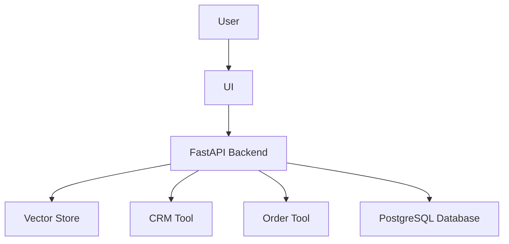

# Application Architecture

The following diagram shows the target architecture of the application.

## Component Description

1. **UI:** Accepts questions from users.
2. **FastAPI:** Handles requests and coordinates application logic.
3. **Vector Store:** Intended to retrieve relevant document information.
4. **CRM Tool:** Intended to retrieve customer information.
5. **Order Tool:** Intended to retrieve order information.
6. **PostgreSQL:** Intended to store application data.

**Note:** This is the proposed target architecture. The current project uses mock responses and does not yet connect to a real vector store, CRM API, Order API, or PostgreSQL database.
